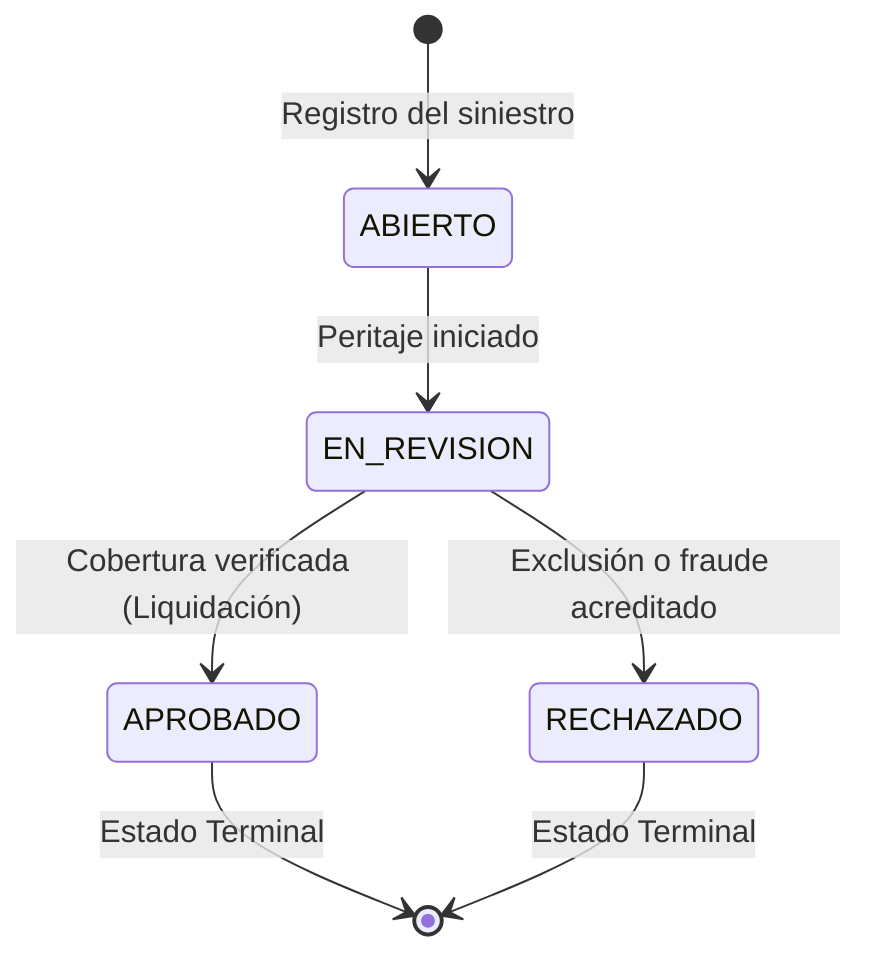

# Documento Funcional: SegurosAPI (Fase 1 - Core API)

> **Nota:** *Modelo simplificado con fines pedagógicos.*

## 1. Objetivo del Proyecto
El objetivo de **SegurosAPI** es proporcionar una API REST robusta, escalable y segura para la gestión integral de clientes, pólizas de seguros (ramos Auto, Hogar y Vida) y la tramitación de siniestros asociados en el mercado asegurador español.

En esta **Fase 1**, el foco se sitúa en la correcta implementación funcional de las entidades del dominio, la validación estricta de entradas (DNI/NIE, formatos, fechas), la lógica de negocio (cálculo de primas y flujos de estados) y el control de errores con consistencia de tipos.

---

## 2. Actores del Sistema
- **Cliente (Tomador del seguro):** Persona física titular de pólizas y afectada por siniestros.
- **Agente de Seguros:** Operador responsable del alta de clientes, cotización y emisión de pólizas, y apertura y seguimiento de siniestros.
- **Administrador:** Responsable global del sistema (en Fase 1 opera a nivel de gestión del catálogo y entidades).

---

## 3. Entidades del Dominio (Fase 1)
*Nota: Las entidades `Usuario` y `AuditLog` se incorporarán en la Fase 2 (Seguridad y Auditoría) mediante una migración Flyway `V2__...`.*

### 3.1. Cliente
- `id` (Long, clave primaria autogenerada).
- `dniNie` (String, único, obligatorio, validado algorítmicamente según especificación oficial del Ministerio del Interior de España).
- `nombre` (String, obligatorio, longitud 2-100).
- `apellidos` (String, obligatorio, longitud 2-100).
- `email` (String, obligatorio, formato email RFC 5322).
- `telefono` (String, obligatorio, formato estándar español: 9 dígitos empezando por 6, 7, 8 o 9).
- `fechaNacimiento` (LocalDate, obligatorio, debe ser fecha pasada y representar mayoría de edad legal: >= 18 años).
- `iban` (String, obligatorio, formato IBAN bancario español: ES seguido de 22 dígitos numéricos).

### 3.2. Póliza
- `id` (Long, clave primaria autogenerada).
- `numero` (String, único, identificador alfanumérico legible, ej: `POL-AUTO-2026-0001`).
- `tipo` (Enum: `AUTO`, `HOGAR`, `VIDA`).
- `estado` (Enum: `ACTIVA`, `SUSPENDIDA`, `CANCELADA`).
- `primaAnual` (BigDecimal, dos decimales, calculado automáticamente con `RoundingMode.HALF_UP`).
- `fechaInicio` (LocalDate, obligatorio, no anterior a la fecha de emisión).
- `fechaFin` (LocalDate, obligatorio, posterior a `fechaInicio`, generalmente vigencia anual).
- `cliente` (Relación ManyToOne con Cliente, obligatorio).

### 3.3. Siniestro
- `id` (Long, clave primaria autogenerada).
- `numero` (String, único, identificador único, ej: `SIN-2026-0001`).
- `poliza` (Relación ManyToOne con Póliza, obligatorio).
- `descripcion` (String, obligatorio, detalle de la incidencia, longitud 10-1000).
- `fechaOcurrencia` (LocalDate, obligatorio, fecha pasada o actual, debe estar dentro de la vigencia de la póliza).
- `importeReclamado` (BigDecimal, positivo, obligatorio, escala 2 y `RoundingMode.HALF_UP`).
- `estado` (Enum: `ABIERTO`, `EN_REVISION`, `APROBADO`, `RECHAZADO`).

---

## 4. Reglas de Negocio

### 4.1. Fórmula de Tarificación de la Prima Anual (`primaAnual`)
La prima anual se calcula de forma determinista mediante la combinación de una tarifa base por ramo y un factor actuarial asociado a la edad del cliente en la fecha de inicio de la póliza:

$$\text{edad} = \text{Period.between}(\text{fechaNacimiento}, \text{fechaInicio}).\text{getYears()}$$

$$\text{primaAnual} = (\text{baseTipo} \times \text{factorEdad}).\text{setScale}(2, \text{RoundingMode.HALF\_UP})$$

> **Regla Crítica de Precisión:** Todo cálculo monetario se realiza exclusivamente con `java.math.BigDecimal` y redondeo `RoundingMode.HALF_UP`. Queda estrictamente prohibido el uso de `float` o `double` para evitar imprecisiones de representación en coma flotante binaria (IEEE 754).

#### A) Tarifas Base por Ramo (`baseTipo`):
- **AUTO:** 500,00 € (cobertura a todo riesgo con franquicia estándar).
- **HOGAR:** 300,00 € (continente y contenido estándar para vivienda habitual).
- **VIDA:** 200,00 € (capital asegurado básico por fallecimiento e invalidez).

#### B) Factores de Ajuste por Edad (`factorEdad`):
- **Ramo AUTO:**
  - Si $\text{edad} < 25$: factor = **1.50** (+50% debido a la alta siniestralidad estadística en conductores jóvenes o noveles).
  - Si $25 \le \text{edad} \le 65$: factor = **1.00** (tarifa neutra estándar).
  - Si $\text{edad} > 65$: factor = **1.20** (+20% por incremento actuarial de tiempos de reacción y riesgo médico al volante).
- **Ramo VIDA:**
  - Si $\text{edad} < 35$: factor = **1.00** (riesgo de mortalidad natural mínimo).
  - Si $35 \le \text{edad} \le 55$: factor = **1.30** (+30% por incremento progresivo de patologías cardiovasculares y crónicas).
  - Si $\text{edad} > 55$: factor = **1.80** (+80% por curva de mortalidad actuarial elevada).
- **Ramo HOGAR:**
  - Para cualquier edad: factor = **1.00** (el riesgo de siniestro en vivienda depende de la edificación y ubicación, no de la edad del tomador).

#### C) Casos de Prueba Límite Obligatorios (Boundary Testing):
Para garantizar que las comparaciones de intervalos de edad no contengan errores de tipo "off-by-one" ($<$ vs $\le$), se definen las siguientes pruebas unitarias de frontera:

| Ramo | Edad | Condición límite evaluada | Factor esperado | Prima resultante esperada |
| :--- | :--- | :--- | :--- | :--- |
| **AUTO** | **24 años** | Frontera superior tramo joven ($\text{edad} < 25$) | **1.50** | $500,00 \times 1.50 = \mathbf{750,00\ \text{€}}$ |
| **AUTO** | **25 años** | Frontera inferior tramo estándar ($25 \le \text{edad}$) | **1.00** | $500,00 \times 1.00 = \mathbf{500,00\ \text{€}}$ |
| **AUTO** | **65 años** | Frontera superior tramo estándar ($\text{edad} \le 65$) | **1.00** | $500,00 \times 1.00 = \mathbf{500,00\ \text{€}}$ |
| **AUTO** | **66 años** | Frontera inferior tramo senior ($\text{edad} > 65$) | **1.20** | $500,00 \times 1.20 = \mathbf{600,00\ \text{€}}$ |
| **VIDA** | **34 años** | Frontera superior tramo joven ($\text{edad} < 35$) | **1.00** | $200,00 \times 1.00 = \mathbf{200,00\ \text{€}}$ |
| **VIDA** | **35 años** | Frontera inferior tramo intermedio ($35 \le \text{edad}$) | **1.30** | $200,00 \times 1.30 = \mathbf{260,00\ \text{€}}$ |
| **VIDA** | **55 años** | Frontera superior tramo intermedio ($\text{edad} \le 55$) | **1.30** | $200,00 \times 1.30 = \mathbf{260,00\ \text{€}}$ |
| **VIDA** | **56 años** | Frontera inferior tramo senior ($\text{edad} > 55$) | **1.80** | $200,00 \times 1.80 = \mathbf{360,00\ \text{€}}$ |
| **HOGAR** | **Cualquiera** | Independiente de la edad | **1.00** | $300,00 \times 1.00 = \mathbf{300,00\ \text{€}}$ |

---

### 4.2. Matriz de Transiciones de Estado para Pólizas
Al registrarse una nueva póliza, se inicializa en estado `ACTIVA`.

| Estado Actual | Transición Permitida Hacia | Motivo de Negocio |
| :--- | :--- | :--- |
| `ACTIVA` | `SUSPENDIDA` | Impago temporal de recibo o solicitud cautelar de suspensión. |
| `ACTIVA` | `CANCELADA` | Solicitud formal de baja por el cliente o vencimiento sin renovación. |
| `SUSPENDIDA` | `ACTIVA` | Regularización de pago de recibos pendientes. |
| `SUSPENDIDA` | `CANCELADA` | Impago prolongado tras plazo legal de requerimiento. |
| `CANCELADA` | *Ninguna* (Terminal) | La póliza ha cesado definitivamente y sus derechos se extinguen. |

*Cualquier intento de transición no permitida (por ejemplo, reactivar una póliza `CANCELADA`) provocará una excepción de negocio que se traducirá en un error HTTP `400 Bad Request`.*

---

### 4.3. Flujo y Máquina de Estados para Siniestros
Regla previa: **Solo se pueden declarar siniestros sobre pólizas en estado `ACTIVA`**. Si la póliza está `SUSPENDIDA` o `CANCELADA`, la declaración es rechazada.

El ciclo de vida del siniestro es estrictamente unidireccional:



- **`ABIERTO`:** Estado inicial tras la comunicación del cliente.
- **`EN_REVISION`:** El siniestro es asignado a un perito o tramitador. Solo se puede pasar a este estado desde `ABIERTO`.
- **`APROBADO`:** Indemnización autorizada. Solo alcanzable desde `EN_REVISION`. Estado terminal.
- **`RECHAZADO`:** Siniestro no cubierto por las condiciones generales o desestimado. Solo alcanzable desde `EN_REVISION`. Estado terminal.

---

### 4.4. Reglas de Integridad de Negocio en la Emisión de Pólizas

#### Nota técnica — Reloj inyectado (`java.time.Clock`)
Todos los controles basados en la fecha actual (`"hoy"`) utilizan un bean `java.time.Clock` con zona horaria `Europe/Madrid`, inyectado como dependencia en los servicios. **Queda prohibido el uso directo de `LocalDate.now()` sin argumento.** Esto permite fijar el reloj en los tests unitarios sin depender de la fecha real del sistema.

```java
// Correcto (testable):
LocalDate hoy = LocalDate.now(clock);

// Incorrecto (no testable, zona horaria implícita del servidor):
LocalDate hoy = LocalDate.now();
```

#### Regla 4.4.1 — Unicidad de póliza activa por ramo y cliente
**Un cliente no puede tener más de una póliza en estado `ACTIVA` del mismo tipo (`tipo`) simultáneamente.**

- **Verificación en servicio:** Antes de emitir, se consulta si existe alguna póliza con `estado = ACTIVA` para el mismo `clienteId` y el mismo `tipo`.
- **Violación detectada:** HTTP **409 Conflict**:
  > *"El cliente ya tiene una póliza ACTIVA de tipo {tipo}. Cancele o suspenda la póliza existente antes de contratar una nueva."*
- **Pólizas `SUSPENDIDA` o `CANCELADA`:** No bloquean la emisión.

**Índice único parcial en PostgreSQL (migración V2):**
```sql
CREATE UNIQUE INDEX uq_polizas_activa_cliente_tipo
    ON polizas (cliente_id, tipo)
    WHERE estado = 'ACTIVA';
```

> **¿Por qué hace falta si el servicio ya verifica?**
>
> El control en el servicio no es suficiente solo. Imagina dos agentes que envían simultáneamente `POST /polizas` para el mismo cliente y el mismo tipo: ambos consultan la base de datos al mismo tiempo, ambos ven que *todavía* no hay ninguna póliza ACTIVA de ese tipo, ambos deciden emitir, y ambos insertan. La base de datos ha aceptado los dos registros antes de que ninguno de los dos pudiera ver el del otro. Esto se llama **condición de carrera** (*race condition*). El índice único parcial actúa como un candado definitivo a nivel de base de datos: PostgreSQL rechazará la segunda inserción con una violación de restricción (`DataIntegrityViolationException`), que el servicio captura y convierte en HTTP **409 Conflict**.

#### Regla 4.4.2 — Fecha de inicio no anterior a la fecha de emisión
**`fechaInicio` debe ser mayor o igual a `LocalDate.now(clock)`** (fecha a efecto inmediato permitida; sólo se rechaza una fecha en el pasado).

- **Violación detectada:** HTTP **400 Bad Request**:
  > *"La fecha de inicio de la póliza no puede ser anterior a la fecha de hoy ({hoy})."*

#### Nota — Generación de números de póliza y siniestro (migración V2)
Los identificadores legibles (`POL-AUTO-2026-0001`, `SIN-2026-0001`) se generan a partir de **secuencias PostgreSQL**, no con `COUNT(*)+1`.

```sql
-- En V2__sequences_and_constraints.sql
CREATE SEQUENCE seq_poliza_numero START 1 INCREMENT 1;
CREATE SEQUENCE seq_siniestro_numero START 1 INCREMENT 1;
```

> **¿Por qué no `COUNT(*)+1`?**
>
> Si dos transacciones calculan `COUNT(*)+1` al mismo tiempo, ambas obtienen el mismo número y una de las dos falla al intentar insertar por la restricción `UNIQUE`. Con una secuencia PostgreSQL, cada llamada a `nextval('seq_poliza_numero')` es atómica y garantizada única, incluso con miles de peticiones simultáneas.

---

### 4.5. Reglas de Integridad de Negocio en la Declaración de Siniestros

**Orden de verificación obligatorio** (el servicio debe respetar este orden exacto para producir mensajes de error coherentes):

| Paso | Control | Error si falla |
| :---: | :--- | :--- |
| **1** | La póliza referenciada por `polizaId` existe en la base de datos | **404 Not Found** |
| **2** | `poliza.estado == ACTIVA` | **409 Conflict** (mensaje específico según estado) |
| **3** | `poliza.fechaFin >= LocalDate.now(clock)` (póliza no expirada) | **409 Conflict** (mensaje de expiración) |
| **4** | `poliza.fechaInicio <= fechaOcurrencia <= poliza.fechaFin` | **400 Bad Request** |
| **5** | `fechaOcurrencia <= LocalDate.now(clock)` (no en el futuro) | **400 Bad Request** |

> *El paso 3 se ejecuta antes que el paso 4 para que el mensaje de error sea preciso: si la póliza está expirada, el motivo real es la expiración, no que la fecha de ocurrencia esté "fuera de rango".*

#### Regla 4.5.1 — Estado de la póliza (paso 2)
**Solo se pueden declarar siniestros sobre pólizas en estado `ACTIVA`.**

- `SUSPENDIDA` → **409 Conflict**:
  > *"No se puede declarar un siniestro sobre una póliza SUSPENDIDA. Es necesario regularizar el pago primero."*
- `CANCELADA` → **409 Conflict**:
  > *"No se puede declarar un siniestro sobre una póliza CANCELADA."*

#### Regla 4.5.2 — Póliza no expirada en la fecha del servidor (paso 3)
**Una póliza con `estado = ACTIVA` pero `fechaFin < LocalDate.now(clock)` se considera expirada.** Esta situación es una inconsistencia tolerable en ausencia de un proceso automático de renovación.

- **Verificación:** `poliza.getFechaFin().isBefore(LocalDate.now(clock))`
- **Violación detectada:** **409 Conflict**:
  > *"No se puede declarar un siniestro sobre una póliza expirada (vigencia finalizada el {fechaFin})."*

#### Regla 4.5.3 — Vigencia temporal de la fecha de ocurrencia (paso 4)
**`fechaInicio ≤ fechaOcurrencia ≤ fechaFin`** (ambos extremos incluidos).

- **Violación detectada:** **400 Bad Request**:
  > *"La fecha de ocurrencia ({fechaOcurrencia}) no está dentro del período de vigencia de la póliza ({fechaInicio} – {fechaFin})."*

#### Regla 4.5.4 — Fecha de ocurrencia no futura (paso 5)
**`fechaOcurrencia` no puede ser posterior a `LocalDate.now(clock)`.**

- **Violación detectada:** **400 Bad Request**:
  > *"La fecha de ocurrencia no puede ser una fecha futura."*

> *Esta regla se aplica en la capa de servicio aunque `@PastOrPresent` ya la cubra en el DTO: la doble comprobación garantiza la coherencia incluso si el DTO es invocado directamente (test de integración, etc.).*

---

### 4.6. Algoritmo de Validación DNI / NIE (Módulo 23)
La tabla de correspondencias del Ministerio del Interior es:
`TRWAGMYFPDXBNJZSQVHLCKE` (índices 0 a 22).

1. **DNI:**
   - Formato: 8 dígitos numéricos seguidos de 1 letra.
   - Cálculo: $\text{resto} = \text{número (8 dígitos)} \pmod{23}$. La letra en la posición `resto` debe coincidir con la letra del DNI.
2. **NIE:**
   - Formato: 1 letra inicial ('X', 'Y', 'Z') seguida de 7 dígitos y 1 letra de control.
   - Normalización de la letra inicial:
     - `X` $\rightarrow$ se reemplaza por `0`
     - `Y` $\rightarrow$ se reemplaza por `1`
     - `Z` $\rightarrow$ se reemplaza por `2`
   - Se forma un número de 8 dígitos y se aplica el mismo algoritmo módulo 23.

---

## 5. Especificación Técnica de la API REST (Fase 1)

### 5.1. Estándar de Errores: ProblemDetail (RFC 7807)
Todas las respuestas de error devueltas por la API siguen el estándar internacional **RFC 7807 (`application/problem+json`)**, implementado a través de la clase `org.springframework.http.ProblemDetail`.

#### A) Estructura JSON estándar:
```json
{
  "type": "about:blank",
  "title": "Conflicto de negocio",
  "status": 409,
  "detail": "El cliente ya tiene una póliza ACTIVA de tipo AUTO. Cancele o suspenda la póliza existente antes de contratar una nueva.",
  "instance": "/api/v1/polizas",
  "timestamp": "2026-10-17T20:30:00Z"
}
```

#### B) Estructura para Errores de Validación Bean (HTTP 400):
Cuando la validación de un DTO de entrada falla (`@Valid`), se incorpora la extensión `invalidParams` o `errors` con el detalle de cada campo infractor:
```json
{
  "type": "about:blank",
  "title": "Error de validación",
  "status": 400,
  "detail": "La solicitud contiene parámetros inválidos",
  "instance": "/api/v1/clientes",
  "timestamp": "2026-10-17T20:30:00Z",
  "errors": [
    {
      "campo": "dniNie",
      "mensaje": "El DNI/NIE no tiene un formato válido"
    },
    {
      "campo": "email",
      "mensaje": "El formato del correo electrónico no es válido"
    }
  ]
}
```

#### C) Matriz de Mapeo de Excepciones a Códigos HTTP:

| Excepción Java | Código HTTP | Razón / Escenario |
| :--- | :---: | :--- |
| `ResourceNotFoundException` | **404 Not Found** | Identificador de cliente, póliza o siniestro inexistente en base de datos. |
| `BusinessConflictException` | **409 Conflict** | Violación de regla de unicidad activa (4.4.1), póliza suspendida/cancelada/expirada en siniestro, cliente con pólizas activas. |
| `BusinessRuleException` | **400 Bad Request** | Fecha en el pasado (4.4.2), siniestro fuera de vigencia o futuro (4.5.3, 4.5.4), transición de estado inválida, cliente menor de edad. |
| `MethodArgumentNotValidException` | **400 Bad Request** | Faltan campos obligatorios `@NotNull`, `@NotBlank`, formatos erróneos `@Pattern`, importes no positivos `@Positive`. |
| `DataIntegrityViolationException` | **409 Conflict** | Detección de colisión concurrente a nivel base de datos no capturada previamente (ej: colisión de índice único). |
| `Exception` (cualquier error no controlado) | **500 Internal Server Error** | Fallo imprevisto del servidor. Mensaje neutro y controlado. |

#### D) Reglas de Seguridad OWASP para el Manejo de Errores:
1. **Cero fugas de información interna:** El `GlobalExceptionHandler` **NUNCA** devuelve la traza de la pila (*stack trace*), nombres de tablas SQL, ni mensajes de error de bajo nivel del driver PostgreSQL en las respuestas HTTP.
2. **Registro seguro (Logging):** Las excepciones se registran en los logs del servidor con nivel `ERROR` o `WARN` con su contexto, mientras que el cliente HTTP sólo recibe mensajes de negocio claros y depurados.

---

### 5.2. Paginación y Protección de Datos Sensibles (PII)

1. **Paginación uniforme:** Todos los listados (`GET`) soportan paginación mediante `org.springframework.data.domain.Pageable`:
   - Parámetros query: `?page=0&size=20&sort=createdAt,desc`.
   - Las respuestas devuelven una estructura paginada estándar (`content`, `pageable`, `totalElements`, `totalPages`, etc.).
2. **Enmascaramiento de PII:** 
   - El DNI/NIE se expone enmascarado: `*****678Z`.
   - El IBAN se expone enmascarado: `ES12 **** **** 3456`.
   - Ninguna respuesta expone contraseñas, claves internas ni proxies Hibernate.

---

### 5.3. Catálogo Detallado de Endpoints REST

#### 5.3.1. Clientes (`/api/v1/clientes`)

| Método | URL | DTO Entrada | DTO Salida | Códigos HTTP | Descripción / Comportamiento |
| :--- | :--- | :--- | :--- | :--- | :--- |
| `POST` | `/api/v1/clientes` | `ClienteCreateRequest` | `ClienteResponse` | `201 Created`<br>`400 Bad Request`<br>`409 Conflict` | Crea un nuevo cliente asegurado. Valida DNI/NIE módulo 23, IBAN, mayoría de edad ($\ge 18$ años). |
| `GET` | `/api/v1/clientes` | *Ninguno (Query params de paginación)* | `Page<ClienteResponse>` | `200 OK` | Listado paginado de clientes ordenado por fecha de creación descendente. |
| `GET` | `/api/v1/clientes/{id}` | *Path variable: `id`* | `ClienteResponse` | `200 OK`<br>`404 Not Found` | Consulta detallada del cliente por su ID. |
| `PUT` | `/api/v1/clientes/{id}` | `ClienteUpdateRequest` | `ClienteResponse` | `200 OK`<br>`400 Bad Request`<br>`404 Not Found` | Modifica los datos de contacto y facturación (nombre, apellidos, email, teléfono, IBAN). |
| `DELETE` | `/api/v1/clientes/{id}` | *Path variable: `id`* | *Ninguno (Void)* | `204 No Content`<br>`404 Not Found`<br>`409 Conflict` | Elimina el cliente. Rechazado con 409 si tiene alguna póliza en estado `ACTIVA`. |

#### 5.3.2. Pólizas (`/api/v1/polizas`)

| Método | URL | DTO Entrada | DTO Salida | Códigos HTTP | Descripción / Comportamiento |
| :--- | :--- | :--- | :--- | :--- | :--- |
| `POST` | `/api/v1/polizas` | `PolizaCreateRequest` | `PolizaResponse` | `201 Created`<br>`400 Bad Request`<br>`404 Not Found`<br>`409 Conflict` | Emite una nueva póliza. Calcula automáticamente `primaAnual` en BigDecimal. Aplica Regla 4.4.1 (unicidad activa) y Regla 4.4.2 (`fechaInicio >= hoy`). Genera número `POL-{TIPO}-{ANIO}-{0001}`. |
| `GET` | `/api/v1/polizas/{id}` | *Path variable: `id`* | `PolizaResponse` | `200 OK`<br>`404 Not Found` | Consulta de póliza por su ID, con DNI/NIE de titular enmascarado. |
| `GET` | `/api/v1/polizas/numero/{numero}` | *Path variable: `numero`* | `PolizaResponse` | `200 OK`<br>`404 Not Found` | Consulta de póliza por su número legible único (ej: `POL-AUTO-2026-0001`). |
| `GET` | `/api/v1/polizas/cliente/{clienteId}` | *Path variable: `clienteId`* | `List<PolizaResponse>` | `200 OK`<br>`404 Not Found` | Lista todas las pólizas pertenecientes a un cliente dado. |
| `PATCH` | `/api/v1/polizas/{id}/estado` | `PolizaEstadoUpdateRequest` | `PolizaResponse` | `200 OK`<br>`400 Bad Request`<br>`404 Not Found`<br>`409 Conflict` | Transición controlada de estado según la matriz: `ACTIVA` $\leftrightarrow$ `SUSPENDIDA` $\rightarrow$ `CANCELADA`. Reactivación a `ACTIVA` revérifie la Regla 4.4.1. |

#### 5.3.3. Siniestros (`/api/v1/siniestros`)

| Método | URL | DTO Entrada | DTO Salida | Códigos HTTP | Descripción / Comportamiento |
| :--- | :--- | :--- | :--- | :--- | :--- |
| `POST` | `/api/v1/siniestros` | `SiniestroCreateRequest` | `SiniestroResponse` | `201 Created`<br>`400 Bad Request`<br>`404 Not Found`<br>`409 Conflict` | Declara un nuevo siniestro respetando estrictamente el orden de las 5 verificaciones (404 si póliza no existe, 409 si póliza no ACTIVA o expirada, 400 si fecha fuera de rango o futura). Genera número `SIN-{ANIO}-{0001}` e inicializa en `ABIERTO`. |
| `GET` | `/api/v1/siniestros/{id}` | *Path variable: `id`* | `SiniestroResponse` | `200 OK`<br>`404 Not Found` | Consulta de un siniestro por su ID. |
| `GET` | `/api/v1/siniestros/numero/{numero}` | *Path variable: `numero`* | `SiniestroResponse` | `200 OK`<br>`404 Not Found` | Consulta de un siniestro por su número de expediente único (ej: `SIN-2026-0001`). |
| `GET` | `/api/v1/siniestros/poliza/{polizaId}` | *Path variable: `polizaId`* | `List<SiniestroResponse>` | `200 OK`<br>`404 Not Found` | Lista todos los siniestros asociados a una póliza dada. |
| `PATCH` | `/api/v1/siniestros/{id}/estado` | `SiniestroEstadoUpdateRequest` | `SiniestroResponse` | `200 OK`<br>`400 Bad Request`<br>`404 Not Found` | Avance del ciclo de vida del siniestro: `ABIERTO` $\rightarrow$ `EN_REVISION` $\rightarrow$ `APROBADO` / `RECHAZADO` (estados terminales). |

