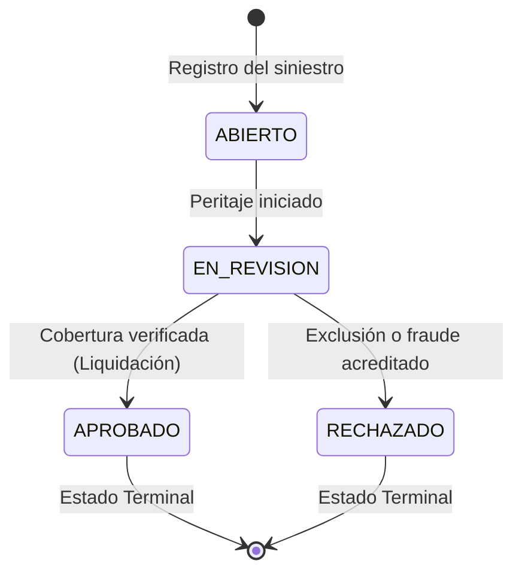

# Documento Funcional: SegurosAPI (Fase 1 - Core API)

> **Nota:** *Modelo simplificado con fines pedagógicos.*

## 1. Objetivo del Proyecto
El objetivo de **SegurosAPI** es proporcionar una API REST robusta, escalable y segura para la gestión integral de clientes, pólizas de seguros (ramos Auto, Hogar y Vida) y la tramitación de siniestros asociados en el mercado asegurador español.

En esta **Fase 1**, el foco se sitúa en la correcta implementación funcional de las entidades del dominio, la validación estricta de entradas (DNI/NIE, formatos, fechas), la lógica de negocio (cálculo de primas y flujos de estados) y el control de errores con consistencia de tipos.

---

## 2. Actores del Sistema
- **Cliente (Tomador del seguro):** Persona física titular de pólizas y afectada por siniestros.
- **Agente de Seguros:** Operador responsable del alta de clientes, cotización y emisión de pólizas, y apertura y seguimiento de siniestros.
- **Administrador:** Responsable global del sistema (en Fase 1 opera a nivel de gestión del catálogo y entidades).

---

## 3. Entidades del Dominio (Fase 1)
*Nota: Las entidades `Usuario` y `AuditLog` se incorporarán en la Fase 2 (Seguridad y Auditoría) mediante una migración Flyway `V2__...`.*

### 3.1. Cliente
- `id` (Long, clave primaria autogenerada).
- `dniNie` (String, único, obligatorio, validado algorítmicamente según especificación oficial del Ministerio del Interior de España).
- `nombre` (String, obligatorio, longitud 2-100).
- `apellidos` (String, obligatorio, longitud 2-100).
- `email` (String, obligatorio, formato email RFC 5322).
- `telefono` (String, obligatorio, formato estándar español: 9 dígitos empezando por 6, 7, 8 o 9).
- `fechaNacimiento` (LocalDate, obligatorio, debe ser fecha pasada y representar mayoría de edad legal: >= 18 años).
- `iban` (String, obligatorio, formato IBAN bancario español: ES seguido de 22 dígitos numéricos).

### 3.2. Póliza
- `id` (Long, clave primaria autogenerada).
- `numero` (String, único, identificador alfanumérico legible, ej: `POL-AUTO-2026-0001`).
- `tipo` (Enum: `AUTO`, `HOGAR`, `VIDA`).
- `estado` (Enum: `ACTIVA`, `SUSPENDIDA`, `CANCELADA`).
- `primaAnual` (BigDecimal, dos decimales, calculado automáticamente con `RoundingMode.HALF_UP`).
- `fechaInicio` (LocalDate, obligatorio, no anterior a la fecha de emisión).
- `fechaFin` (LocalDate, obligatorio, posterior a `fechaInicio`, generalmente vigencia anual).
- `cliente` (Relación ManyToOne con Cliente, obligatorio).

### 3.3. Siniestro
- `id` (Long, clave primaria autogenerada).
- `numero` (String, único, identificador único, ej: `SIN-2026-0001`).
- `poliza` (Relación ManyToOne con Póliza, obligatorio).
- `descripcion` (String, obligatorio, detalle de la incidencia, longitud 10-1000).
- `fechaOcurrencia` (LocalDate, obligatorio, fecha pasada o actual, debe estar dentro de la vigencia de la póliza).
- `importeReclamado` (BigDecimal, positivo, obligatorio, escala 2 y `RoundingMode.HALF_UP`).
- `estado` (Enum: `ABIERTO`, `EN_REVISION`, `APROBADO`, `RECHAZADO`).

---

## 4. Reglas de Negocio

### 4.1. Fórmula de Tarificación de la Prima Anual (`primaAnual`)
La prima anual se calcula de forma determinista mediante la combinación de una tarifa base por ramo y un factor actuarial asociado a la edad del cliente en la fecha de inicio de la póliza:

$$\text{edad} = \text{Period.between}(\text{fechaNacimiento}, \text{fechaInicio}).\text{getYears()}$$

$$\text{primaAnual} = (\text{baseTipo} \times \text{factorEdad}).\text{setScale}(2, \text{RoundingMode.HALF\_UP})$$

> **Regla Crítica de Precisión:** Todo cálculo monetario se realiza exclusivamente con `java.math.BigDecimal` y redondeo `RoundingMode.HALF_UP`. Queda estrictamente prohibido el uso de `float` o `double` para evitar imprecisiones de representación en coma flotante binaria (IEEE 754).

#### A) Tarifas Base por Ramo (`baseTipo`):
- **AUTO:** 500,00 € (cobertura a todo riesgo con franquicia estándar).
- **HOGAR:** 300,00 € (continente y contenido estándar para vivienda habitual).
- **VIDA:** 200,00 € (capital asegurado básico por fallecimiento e invalidez).

#### B) Factores de Ajuste por Edad (`factorEdad`):
- **Ramo AUTO:**
  - Si $\text{edad} < 25$: factor = **1.50** (+50% debido a la alta siniestralidad estadística en conductores jóvenes o noveles).
  - Si $25 \le \text{edad} \le 65$: factor = **1.00** (tarifa neutra estándar).
  - Si $\text{edad} > 65$: factor = **1.20** (+20% por incremento actuarial de tiempos de reacción y riesgo médico al volante).
- **Ramo VIDA:**
  - Si $\text{edad} < 35$: factor = **1.00** (riesgo de mortalidad natural mínimo).
  - Si $35 \le \text{edad} \le 55$: factor = **1.30** (+30% por incremento progresivo de patologías cardiovasculares y crónicas).
  - Si $\text{edad} > 55$: factor = **1.80** (+80% por curva de mortalidad actuarial elevada).
- **Ramo HOGAR:**
  - Para cualquier edad: factor = **1.00** (el riesgo de siniestro en vivienda depende de la edificación y ubicación, no de la edad del tomador).

#### C) Casos de Prueba Límite Obligatorios (Boundary Testing):
Para garantizar que las comparaciones de intervalos de edad no contengan errores de tipo "off-by-one" ($<$ vs $\le$), se definen las siguientes pruebas unitarias de frontera:

| Ramo | Edad | Condición límite evaluada | Factor esperado | Prima resultante esperada |
| :--- | :--- | :--- | :--- | :--- |
| **AUTO** | **24 años** | Frontera superior tramo joven ($\text{edad} < 25$) | **1.50** | $500,00 \times 1.50 = \mathbf{750,00\ \text{€}}$ |
| **AUTO** | **25 años** | Frontera inferior tramo estándar ($25 \le \text{edad}$) | **1.00** | $500,00 \times 1.00 = \mathbf{500,00\ \text{€}}$ |
| **AUTO** | **65 años** | Frontera superior tramo estándar ($\text{edad} \le 65$) | **1.00** | $500,00 \times 1.00 = \mathbf{500,00\ \text{€}}$ |
| **AUTO** | **66 años** | Frontera inferior tramo senior ($\text{edad} > 65$) | **1.20** | $500,00 \times 1.20 = \mathbf{600,00\ \text{€}}$ |
| **VIDA** | **34 años** | Frontera superior tramo joven ($\text{edad} < 35$) | **1.00** | $200,00 \times 1.00 = \mathbf{200,00\ \text{€}}$ |
| **VIDA** | **35 años** | Frontera inferior tramo intermedio ($35 \le \text{edad}$) | **1.30** | $200,00 \times 1.30 = \mathbf{260,00\ \text{€}}$ |
| **VIDA** | **55 años** | Frontera superior tramo intermedio ($\text{edad} \le 55$) | **1.30** | $200,00 \times 1.30 = \mathbf{260,00\ \text{€}}$ |
| **VIDA** | **56 años** | Frontera inferior tramo senior ($\text{edad} > 55$) | **1.80** | $200,00 \times 1.80 = \mathbf{360,00\ \text{€}}$ |
| **HOGAR** | **Cualquiera** | Independiente de la edad | **1.00** | $300,00 \times 1.00 = \mathbf{300,00\ \text{€}}$ |

---

### 4.2. Matriz de Transiciones de Estado para Pólizas
Al registrarse una nueva póliza, se inicializa en estado `ACTIVA`.

| Estado Actual | Transición Permitida Hacia | Motivo de Negocio |
| :--- | :--- | :--- |
| `ACTIVA` | `SUSPENDIDA` | Impago temporal de recibo o solicitud cautelar de suspensión. |
| `ACTIVA` | `CANCELADA` | Solicitud formal de baja por el cliente o vencimiento sin renovación. |
| `SUSPENDIDA` | `ACTIVA` | Regularización de pago de recibos pendientes. |
| `SUSPENDIDA` | `CANCELADA` | Impago prolongado tras plazo legal de requerimiento. |
| `CANCELADA` | *Ninguna* (Terminal) | La póliza ha cesado definitivamente y sus derechos se extinguen. |

*Cualquier intento de transición no permitida (por ejemplo, reactivar una póliza `CANCELADA`) provocará una excepción de negocio que se traducirá en un error HTTP `400 Bad Request`.*

---

### 4.3. Flujo y Máquina de Estados para Siniestros
Regla previa: **Solo se pueden declarar siniestros sobre pólizas en estado `ACTIVA`**. Si la póliza está `SUSPENDIDA` o `CANCELADA`, la declaración es rechazada.

El ciclo de vida del siniestro es estrictamente unidireccional:

- **`ABIERTO`:** Estado inicial tras la comunicación del cliente.
- **`EN_REVISION`:** El siniestro es asignado a un perito o tramitador. Solo se puede pasar a este estado desde `ABIERTO`.
- **`APROBADO`:** Indemnización autorizada. Solo alcanzable desde `EN_REVISION`. Estado terminal.
- **`RECHAZADO`:** Siniestro no cubierto por las condiciones generales o desestimado. Solo alcanzable desde `EN_REVISION`. Estado terminal.

---

### 4.4. Algoritmo de Validación DNI / NIE (Módulo 23)
La tabla de correspondencias del Ministerio del Interior es:
`TRWAGMYFPDXBNJZSQVHLCKE` (índices 0 a 22).

1. **DNI:**
   - Formato: 8 dígitos numéricos seguidos de 1 letra.
   - Cálculo: $\text{resto} = \text{número (8 dígitos)} \pmod{23}$. La letra en la posición `resto` debe coincidir con la letra del DNI.
2. **NIE:**
   - Formato: 1 letra inicial ('X', 'Y', 'Z') seguida de 7 dígitos y 1 letra de control.
   - Normalización de la letra inicial:
     - `X` $\rightarrow$ se reemplaza por `0`
     - `Y` $\rightarrow$ se reemplaza por `1`
     - `Z` $\rightarrow$ se reemplaza por `2`
   - Se forma un número de 8 dígitos y se aplica el mismo algoritmo módulo 23.

---

## 5. Catálogo de Endpoints REST (Fase 1)

### 5.1. Clientes (`/api/v1/clientes`)
- `POST /api/v1/clientes` $\rightarrow$ Alta de cliente (valida DNI/NIE único, IBAN, teléfono, fecha nacimiento >= 18 años). Responde `201 Created` o `400/409 Conflict`.
- `GET /api/v1/clientes` $\rightarrow$ Listado paginado de clientes. Responde `200 OK`.
- `GET /api/v1/clientes/{id}` $\rightarrow$ Detalle de cliente por ID. Responde `200 OK` o `404 Not Found`.
- `PUT /api/v1/clientes/{id}` $\rightarrow$ Modificación de datos de contacto (email, teléfono, IBAN). Responde `200 OK` o `400/404`.
- `DELETE /api/v1/clientes/{id}` $\rightarrow$ Baja de cliente (solo si no tiene pólizas activas asociadas). Responde `204 No Content` o `409 Conflict`.

### 5.2. Pólizas (`/api/v1/polizas`)
- `POST /api/v1/polizas` $\rightarrow$ Contratación de póliza. Calcula automáticamente `primaAnual`. Responde `201 Created`.
- `GET /api/v1/polizas` $\rightarrow$ Listado de pólizas (con filtros opcionales por cliente y estado). Responde `200 OK`.
- `GET /api/v1/polizas/{id}` $\rightarrow$ Detalle de póliza. Responde `200 OK` o `404 Not Found`.
- `PATCH /api/v1/polizas/{id}/estado` $\rightarrow$ Cambio controlado de estado (`ACTIVA`, `SUSPENDIDA`, `CANCELADA`). Responde `200 OK` o `400 Bad Request`.

### 5.3. Siniestros (`/api/v1/siniestros`)
- `POST /api/v1/siniestros` $\rightarrow$ Declaración de siniestro sobre póliza activa. Responde `201 Created` o `400 Bad Request`.
- `GET /api/v1/siniestros` $\rightarrow$ Listado de siniestros (con filtros opcionales por póliza y estado). Responde `200 OK`.
- `GET /api/v1/siniestros/{id}` $\rightarrow$ Detalle de siniestro. Responde `200 OK` o `404 Not Found`.
- `PATCH /api/v1/siniestros/{id}/estado` $\rightarrow$ Avance del flujo del siniestro (`EN_REVISION`, `APROBADO`, `RECHAZADO`). Responde `200 OK` o `400 Bad Request`.
